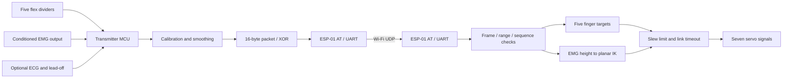

# EMG and Flex-Sensor Robotic Arm

Wearable input for a servo-driven arm: five flex channels command the fingers,
while an EMG envelope selects a planar fingertip-height target. Arduino C/C++
firmware implements calibration, filtering, UDP communication, two-link
kinematics, servo command limiting, and optional ECG beat estimation.
**No machine-learning model is used.**

**Status:** educational prototype software. This review compiled and tested the
software without physical hardware. The supplied wrist mapping saturates and
requires mechanical calibration before powered motion.

## History and engineering problem

Fady Salib reports building the original project in **September–December 2024**:
EMG controlled the arm, and a flex-sensor glove controlled the fingers, using
**two Arduino Unos**. The checked-in firmware instead describes **two classic
Nanos (ATmega328P)**, ESP-01 Wi-Fi modules, AD8232 ECG input, and planar IK.
These source capabilities are not confirmation that they operated in the 2024
prototype. Available Git history starts with an October 2026 upload and does not
establish the implementation dates or validation of individual features.

The engineering problem is converting noisy, user-dependent wearable inputs
into bounded commands while handling calibration and communication loss.
Original sketches, photographs, and schematics are needed to reconcile the
hardware revisions. See the [initial audit and file findings](docs/audit.md).

## Architecture and implemented features



- Flex min/max calibration, exponential smoothing, and selectable wiring polarity.
- EMG resting-baseline subtraction, rectification, smoothing, and peak scaling.
  Inadequate peak calibration produces zero output.
- Optional adaptive-threshold ECG beat estimation with lead-off/timeout handling.
  This is an approximate BPM signal, not medical sensing or a safety interlock.
- Packet magic, XOR integrity, sensor-range validation, and sequence ordering.
- Planar two-link FK/IK; unreachable targets project onto the reachable annulus.
- Nominal angle clamps, command-rate limits (240°/s; 120°/s above 140 BPM), and
  movement toward rest after more than 500 ms without an accepted packet.

The application is open loop: it has no measured joint feedback, 3D solver,
stepper driver, collision model, trajectory planner, or automated pick-and-place.

## Hardware and software stack

This pinout describes current source, not a verified 2024 schematic. Read the
[wiring and power guide](docs/wiring.md) before connecting hardware.

| Board | Function | Pins |
|---|---|---|
| Transmitter | Thumb through pinky flex | A0–A4 |
| Transmitter | Conditioned EMG | A5 |
| Transmitter | Optional AD8232 output; lead-off | A6; D2 / D3 |
| Receiver | Thumb through pinky servos | D2–D6 |
| Receiver | Elbow / wrist signals | D7 / D8 |
| Both | ESP-01 hardware UART | D0 RX / D1 TX |
| Both | Status LED | D13 |

A classic Nano exposes A6/A7; an Uno only exposes A0–A5. The transmitter rejects
a default Uno build. `ARM_ENABLE_ECG=0` permits a six-input Uno build, with BPM
fixed at zero, without remapping flex/EMG. This is a compatibility option, not
evidence of the original firmware. Nano Every, ESP32, Uno R4, and other MCU
architectures are outside this configuration.

Tested tools: Arduino CLI **1.3.1**, Arduino AVR core **1.8.6**, Servo **1.2.2**;
GCC/G++ and Make for host tests. No Python runtime is required. ESP-01 modules
need compatible AT firmware at 9600 baud; an exact bench-tested AT version is
not available. Receiver parsing requires active receive mode, `CIPMUX=1` and
`CIPDINFO=0`.

## Installation and setup

```bash
git clone https://github.com/fady-salib/robotic-arm.git
cd robotic-arm
arduino-cli core update-index
arduino-cli core install arduino:avr@1.8.6
arduino-cli lib install Servo@1.2.2
cp firmware/transmitter/secrets.example.h firmware/transmitter/secrets.h
cp firmware/receiver/secrets.example.h firmware/receiver/secrets.h
```

Edit the ignored `secrets.h` files locally. Set SSID/password and the receiver's
reserved IP in `DEST_IP`; `192.0.2.1` is a documentation placeholder. Use simple
AT credential strings without quotes, backslashes, commas, or line breaks.
Do not publish credentials or credential-bearing firmware binaries. Use a
private isolated network: packets have no authentication or encryption.

```bash
arduino-cli compile --fqbn arduino:avr:nano:cpu=atmega328 --libraries libraries firmware/transmitter
arduino-cli compile --fqbn arduino:avr:nano:cpu=atmega328 --libraries libraries firmware/receiver
```

For an old-bootloader Nano use `cpu=atmega328old`. For an Uno transmitter select
`--fqbn arduino:avr:uno` and add
`--build-property compiler.cpp.extra_flags=-DARM_ENABLE_ECG=0`; its receiver
uses the Uno FQBN directly.

Disconnect ESP-01 UART wires during USB uploads. Identify the actual port with
`arduino-cli board list`, then upload using the same FQBN, for example:

```bash
arduino-cli upload --fqbn arduino:avr:nano:cpu=atmega328 --port /dev/ttyUSB0 firmware/transmitter
```

Repeat for the receiver and its port. This UART belongs to the ESP-01; do not
use Serial Monitor/debug prints on it. Keep servo power disconnected until the
mechanical ranges, pulse limits, rest pose, and kinematic mapping are verified.

## Calibration and demonstration

1. Begin unloaded with servo power off. Confirm board labels, sensor voltage
   limits, grounds, and flex-divider polarity using the wiring guide.
2. Start the receiver on the isolated network. It sets rest commands before
   Wi-Fi setup. With servo power present, startup can cause immediate movement:
   the software does not know actual initial shaft positions.
3. Start the transmitter. Wi-Fi setup failure causes fast blinking and retries.
   After connection, approximately two seconds of slow blinking learns the EMG
   baseline: relax the muscle.
4. During approximately four seconds of solid LED, sweep every finger through
   its intended range and contract the muscle deliberately. Calibration is
   RAM-only and repeats after reset. A flex span below 30 counts or EMG peak
   below 25 counts is unusable. Zero sensor output commands open fingers or
   low target height; it does not disable actuators or prove sensor connection.
5. With servos unpowered, inspect captured commands or temporary diagnostics.
   Set `FLEX_INVERT` for channels whose ADC decreases as the finger bends.
   The calibration sweep cannot infer open/closed direction.
6. Measure mounting signs/offsets, link lengths and safe pulse limits before
   changing receiver constants. **The default wrist mapping cannot track the
   specified IK path.** Test individual servos unloaded with a power cutoff
   before testing coupled motion.
7. On an isolated bench, record finger input, muscle input and link loss. The
   receiver LED indicates accepted fresh packets; timeout moves toward rest.
   Rest movement itself may be hazardous under load.

Nominal EMG/ECG sampling is ~250 Hz, with at most 20 packet requests/s. These are
cooperative scheduling targets, not measured timing guarantees. See
[implementation details](docs/implementation.md).

## Testing and supported results

```bash
make test
bash tools/build_firmware.sh
```

The build script stages example credentials, builds both sketches for two Nano
bootloaders and Uno (ECG disabled on its transmitter), and verifies rejection of
ECG-enabled Uno builds. It never uploads firmware. Set `ARDUINO_CLI` for a custom
CLI path; additional global CLI options may follow the script.

Host tests compile C logic and both real sketches against simulated hardware
interfaces with warnings as errors, AddressSanitizer and UBSan. They check
calibration, synthetic ECG, packet corruption/ranges/order, IK round trips,
parser recovery, send acknowledgments, and timeout/stall behavior. Mocks do not
model actual AT firmware, sensor accuracy, electrical behavior, or pulse timing.
For ptrace-restricted runners use `ASAN_OPTIONS=detect_leaks=0 make test`;
this explicitly disables leak detection.

On **2026-10-29**, all four host executables passed (the sender runs with three
fault modes), six AVR configurations compiled, and the expected Uno ECG rejection
passed. [Verification details](docs/verification.md) record memory and warnings.
No physical accuracy, latency, EMG discrimination, or ECG accuracy measurement
is available. The added GitHub workflow's remote status is separate from these
local results.

## Limitations and future work

- Two-Uno prototype versus Nano/ESP-01/ECG source provenance remains unresolved.
- Default link lengths and servo offsets are unverified. Wrist relative IK
  angles exceed 90° along the configured target path; adding 90° makes all
  wrist commands clamp to 180°. Nominal angle bounds are not mechanical limits.
- Baseline/envelope filtering is not a full EMG front end. 250 Hz cannot capture
  unconditioned broadband EMG; sensor conditioning and anti-alias filtering
  need confirmation. Flex ADC source impedance and mux settling need measurement.
- XOR misses many multi-byte corruptions. No authentication, timestamps,
  retransmission, persistent packet-loss counters, or automatic Wi-Fi recovery
  exist. Sequence history resets after timeout; replayed/delayed packets can be
  accepted in a new epoch.
- Ambiguous send timeout/errors latch transmission until MCU/module restart,
  allowing the receiver to time out instead of issuing potentially misframed AT
  retries. Recovery still needs bench validation.
- No joint feedback, force sensing, collision avoidance, emergency-stop circuit,
  or guarantee of safe rest movement is implemented.

Next steps are hardware provenance, measured servo calibration, sensor waveform
and timing capture, AT compatibility tests, and repeatable unloaded tracking
experiments. Stronger versioned packet integrity/freshness is a possible future
protocol change requiring coordinated firmware updates.

## Media, contributions, and license

Fady Salib owns the project. Original dates/functionality are owner-reported;
source capabilities and review evidence are distinguished above. The 2026
repository review used AI-assisted code review, tests, and documentation.
Arduino AVR core and Servo are upstream dependencies. Cite actual AD8232 and
ESP-01 module/AT revisions when identified. The existing [MIT license](LICENSE)
and original notice are retained.

No demonstration media is committed. Use the [media guide](docs/media.md) to add
existing photos/video links labeled by date and hardware revision. See
[CV and LinkedIn drafts](docs/portfolio.md) for evidence-conscious wording.
