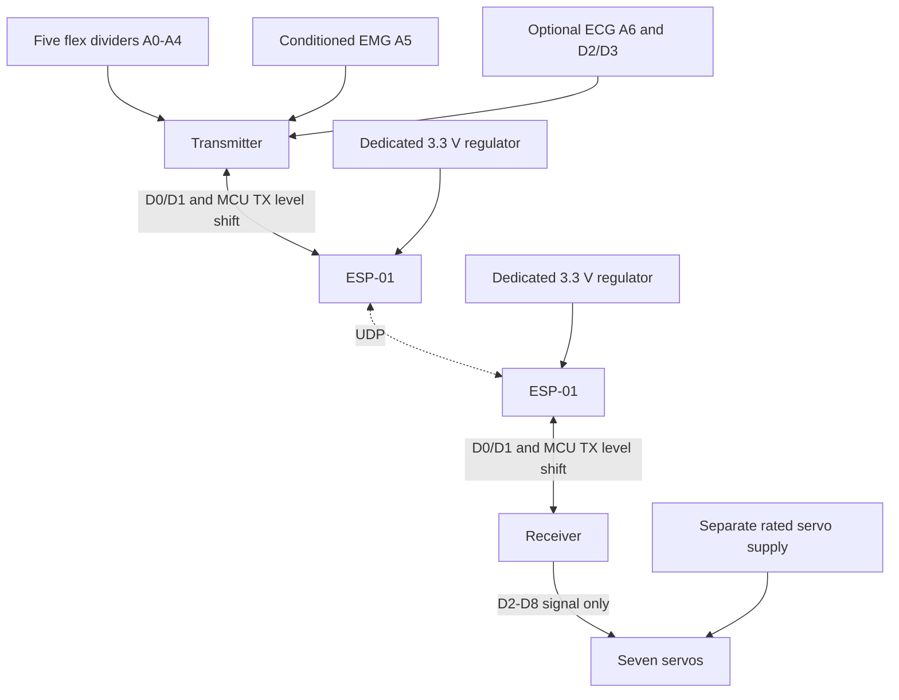

# Source-derived wiring guide

This describes the current firmware, not a verified as-built schematic. The
owner reports two Unos in 2024; the checked-in transmitter needs Nano A6 for
ECG. On Uno, explicitly disable ECG with `ARM_ENABLE_ECG=0`. Do not silently
reinterpret the original hardware as Nano-based.

The diagram omits power return lines: share a suitable ground reference within
each circuit. It is not a circuit or human-isolation certification.

## ESP-01 on both boards

| ESP-01 | Connection |
|---|---|
| VCC and EN/CH_PD | Dedicated regulated 3.3 V supply rated for module current peaks, with local decoupling; do not power ESP from the MCU board's small 3.3 V output |
| GND | Common logic ground |
| TX | MCU RX / D0; verify actual input thresholds |
| RX | MCU TX / D1 through a suitable level interface; original example is 1 kΩ series, 2 kΩ to ground |
| Reset/boot pins | Exact module's normal-boot reference circuit |

Use compatible AT firmware at **9600 baud**. A common one-time command is
`AT+UART_DEF=9600,8,1,0,0`; older firmware differs. Record `AT+GMR` before bench
tests. Receiver setup requires `AT+CIPDINFO=0` and fails visibly if unsupported.
Only active `+IPD,<id>,<length>:` frames are parsed; passive receive/remote-IP
metadata is unsupported. Disable passive mode if previously configured.

D0/D1 share the USB adapter. Disconnect ESP UART wires during uploads; avoid
simultaneous USB TX and ESP TX driving the same MCU RX net. Use appropriate
jumpers/isolation for the actual board. No debug text can share this UART.

## Transmitter

| Function | Pin |
|---|---|
| Thumb / index / middle / ring / pinky | A0 / A1 / A2 / A3 / A4 |
| Conditioned EMG signal | A5 |
| Optional AD8232 output | A6 (Nano only) |
| AD8232 LO+ / LO− | D2 / D3 |
| Onboard status LED | D13 |

Original divider example: 5 V → flex resistor → ADC → 10 kΩ → GND. Increasing
flex resistance decreases the ADC voltage in this circuit; confirm actual
behavior and set `FLEX_INVERT` per channel. Min/max calibration does not determine
direction. High source impedance may require settling/buffering; oversampling
alone does not establish ADC accuracy.

Confirm sensor supplies, signal limits, EMG conditioning and anti-alias filters
before connection. The original AD8232 example uses 3.3 V; verify module demand
and regulator capacity. For body electrodes, follow manufacturer battery-power
and isolation instructions. USB, bench supplies and motor grounds are not medical
isolation; this guide does not validate body-connected testing.

## Receiver

| Servo | Signal pin |
|---|---|
| Thumb / index / middle / ring / pinky | D2 / D3 / D4 / D5 / D6 |
| Elbow / wrist | D7 / D8 |
| Onboard status LED | D13 |

Servo uses Timer1 on ATmega328P; consider PWM interactions on D9/D10 for later
changes. Seven channels fit its 12-channel capacity. Hardware UART is used to
avoid SoftwareSerial timing disturbance. These are hobby-servo pulses, not
stepper Step/Dir signals.

Use a separate fused servo supply rated for actual voltage and combined stall
current, with an accessible power cutoff. The original guide suggests 5–6 V,
but servo models/current measurements are absent. Never power seven servos from
USB or the MCU regulator. Check grounds, decoupling, and travel unloaded. The
500–2400 µs range, 10–170° finger commands and 90° arm rest are defaults, not
measured safe limits. Startup rest commands can immediately move the mechanism.
